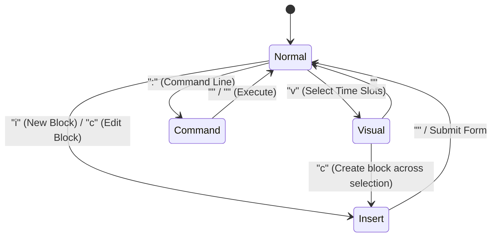
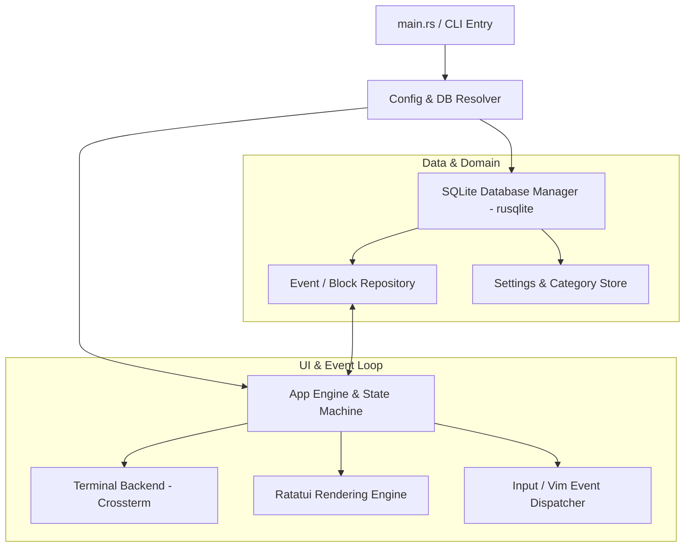
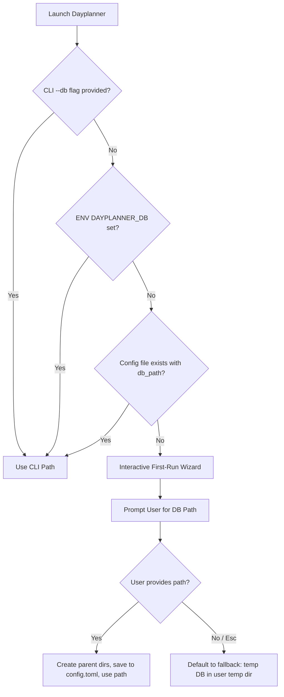

# Dayplanner TUI: Engineering Architecture & Implementation Plan

**Target Application**: Terminal User Interface (TUI) Day Planner  
**Stack**: Rust, Ratatui, Crossterm, SQLite (bundled `rusqlite`)  
**Reference Document**: [proposal.md](file:///home/lmb/Desktop/projects/dayplanner/docs/proposal.md)

---

## 1. Executive Summary

The goal of **Dayplanner** is to deliver the intuitive, time-blocked scheduling experience of modern calendar tools (like Microsoft Teams Calendar / Google Calendar) within a high-performance, cross-platform terminal interface powered by **Ratatui** and native **Vim motions**.

### Key Deliverables
1. **Time-Blocked Calendar Grid**: Vertical 24-hour / customizable workday timeline with day/week views, supporting discrete blocks (15- or 30-minute granularity), overlapping block resolution, and visual tags.
2. **True Vim Modal Engine**: Dedicated `NORMAL`, `INSERT`, `VISUAL`, and `COMMAND` modes for frictionless, mouse-free scheduling and navigation.
3. **Zero-Friction Portability & Storage**: Standalone statically linkable binary using embedded SQLite (`rusqlite` bundled). 
4. **Smart DB Path Resolution**: First-run onboarding prompt, CLI/env overrides, config persistence (`~/.config/dayplanner/config.toml`), and safe fallback to temporary storage.

---

## 2. User Experience & TUI Layout

### 2.1 Interface Layout

```
┌─[ Dayplanner: 2026-10-17 ]─────────────────────────────────────────[ ? Help ]─┐
│ Time  │ [Mon 10/12] │ [Tue 10/13] │ [Wed 10/14] │ [Today - Sat 10/17]        │
├───────┼─────────────┼─────────────┼─────────────┼────────────────────────────┤
│ 08:00 │             │             │             │ ┌────────────────────────┐ │
│ 08:30 │             │             │             │ │ Morning Standup (Work) │ │
│ 09:00 │             │             │             │ └────────────────────────┘ │
│ 09:30 │             │             │             │ ┌────────────────────────┐ │
│ 10:00 │             │             │             │ │ Architecture Planning  │ │
│ 10:30 │             │             │             │ │ (Deep Work)            │ │
│ 11:00 │             │             │             │ └────────────────────────┘ │
│ 11:30 │             │             │             │                            │
│ 12:00 │             │             │             │ ┌────────────────────────┐ │
│ 12:30 │             │             │             │ │ Lunch Break            │ │
│ 13:00 │             │             │             │ └────────────────────────┘ │
│ ...   │             │             │             │                            │
├───────┴─────────────┴─────────────┴─────────────┴────────────────────────────┤
│ [NORMAL] Selected: 10:00 - 11:00 ("Architecture Planning")                   │
│ :db /home/lmb/documents/leeosvault/misc/dayplanner.db                        │
└──────────────────────────────────────────────────────────────────────────────┘
```

### 2.2 Views
- **Day View (`1` or `vd`)**: Detailed single-day breakdown with side-by-side overlap resolution and full descriptions.
- **3-Day View (`3` or `v3`)**: Yesterday, Today, Tomorrow overview.
- **Week View (`w` or `vw`)**: 7-day Monday–Sunday column view.
- **Agenda / Sidebar Toggle (`<Tab>` or `a`)**: Compact list of upcoming blocks and untimed tasks.

---

## 3. Vim Motion & Interaction System

The application implements a strict state machine replicating standard Vim ergonomics:

### 3.1 Modal State Machine



### 3.2 Keybindings by Mode

#### **NORMAL Mode (Navigation & Quick Actions)**
- `h` / `l`: Move cursor left/right across days.
- `j` / `k`: Move cursor up/down in time (15 or 30-min increments).
- `Ctrl-d` / `Ctrl-u`: Jump 4 hours down / up.
- `gg` / `G`: Jump to start of workday (e.g., 08:00) / end of workday (e.g., 18:00).
- `H` / `L`: Jump to beginning / end of week.
- `t`: Jump to current time slot (Now).
- `w` / `b`: Jump to next / previous scheduled event block.
- `i` / `o`: Open block creation modal at current slot (`o` creates directly below).
- `c` / `cw`: Edit currently highlighted block (title, time, color/tag).
- `dd`: Delete highlighted block (with undo support via `u`).
- `J` / `K` (Shift+j/k): Nudge / drag existing block up or down by 15 mins.
- `>` / `<`: Increase / decrease block duration by 15 mins.
- `y` / `p`: Yank (copy) and paste block to cursor position.
- `/`: Quick filter / search events across the calendar.

#### **VISUAL Mode (Time Slot Range Selection)**
- `v`: Enter visual mode at the current slot.
- `j` / `k`: Expand or shrink selection range (e.g. dragging a 10:00 to 12:30 block).
- `c` / `a`: Turn selected time range into a new block.
- `d`: Delete all blocks falling within selection range.

#### **INSERT Mode (Popup Form / Inline Editor)**
- Clean Ratatui floating modal dialog with fields:
  - **Title** (auto-focused)
  - **Category / Tag** (with color preview: Work, Personal, Fitness, etc.)
  - **Start / End Time** (prefilled from grid selection)
  - **Notes / Description**
- Navigation: `Tab` / `Shift-Tab` to switch fields, `Enter` to save, `Esc` to cancel.

#### **COMMAND Mode (`:`)**
- `:w` — Flush changes to SQLite immediately.
- `:q` / `:q!` — Quit application.
- `:db <path>` — Switch database or view current active DB path.
- `:goto YYYY-MM-DD` or `:goto today` — Navigate date.
- `:export ics` or `:export json` — Export calendar data.

---

## 4. Architecture & Technical Design

### 4.1 System Components



### 4.2 SQLite Database Engine & Portability
- **Library**: `rusqlite` with the `bundled` feature flag. This compiles SQLite directly into the Rust binary, guaranteeing zero runtime C library version mismatch across Linux distros, macOS, or Windows.
- **Embedded Migrations**: `rusqlite_migration` executes schema updates automatically on startup.

#### Schema
```sql
CREATE TABLE IF NOT EXISTS meta (
    key TEXT PRIMARY KEY,
    value TEXT NOT NULL
);

CREATE TABLE IF NOT EXISTS categories (
    id TEXT PRIMARY KEY,
    name TEXT NOT NULL,
    color TEXT NOT NULL, -- Hex or Ratatui Color name
    icon TEXT
);

CREATE TABLE IF NOT EXISTS blocks (
    id TEXT PRIMARY KEY,
    title TEXT NOT NULL,
    description TEXT,
    category_id TEXT REFERENCES categories(id),
    start_time INTEGER NOT NULL, -- Unix timestamp (UTC)
    end_time INTEGER NOT NULL,   -- Unix timestamp (UTC)
    all_day INTEGER DEFAULT 0,
    created_at INTEGER NOT NULL,
    updated_at INTEGER NOT NULL
);

CREATE INDEX IF NOT EXISTS idx_blocks_time_range 
ON blocks(start_time, end_time);
```

### 4.3 Database Path Resolution Hierarchy

To accommodate your requirement (storing data in `/home/lmb/documents/leeosvault/misc` while maintaining seamless fallback and setup for any machine), Dayplanner will resolve its DB path in this exact priority:



1. **CLI Flag**: `dayplanner --db <PATH>`
2. **Environment Variable**: `DAYPLANNER_DB=<PATH>`
3. **Config File**: Located at `$XDG_CONFIG_HOME/dayplanner/config.toml` (e.g. `~/.config/dayplanner/config.toml`).
4. **First-Run Interactive Setup**:
   - If no config exists, prompt user in terminal/TUI:
     ```text
     Welcome to Dayplanner!
     Where would you like to store your calendar database?
     [Default: /home/lmb/documents/leeosvault/misc/dayplanner.db]
     > _
     ```
   - Automatically executes `std::fs::create_dir_all` for nested paths.
5. **Fallback**: If user chooses temporary mode or passes `--temp`:
   - Uses `std::env::temp_dir().join("dayplanner/dayplanner_temp.db")`.

---

## 5. Technology Stack & Crates

| Crate | Purpose | Justification |
| :--- | :--- | :--- |
| `ratatui` (0.29+) | Terminal UI framework | Standard for modern Rust TUIs; rich widget ecosystem, constraint layout. |
| `crossterm` | Terminal backend | Cross-platform event polling (keyboard, mouse, resize) on Windows/Unix. |
| `rusqlite` (`features = ["bundled"]`) | SQLite client | Embedded single-file database, zero external dependencies required on target machine. |
| `rusqlite_migration` | Schema migrations | Clean forward-compatible migrations baked into the binary. |
| `chrono` / `chrono-tz` | Datetime calculations | Robust time math, timezones, leap years, week numbering. |
| `directories-next` | XDG paths | Reliable standard configuration & state directory discovery across OSes. |
| `serde` & `toml` | Configuration serialization | Human-readable `config.toml`. |
| `uuid` | IDs | Generate UUIDv4 for block IDs. |

---

## 6. Implementation Roadmap

### Phase 1: Project Scaffolding & Storage Layer
- Initialize Cargo project with dependencies.
- Build DB Path Resolver and interactive first-run prompt.
- Implement SQLite migrations and CRUD repository for `Block` and `Category`.

### Phase 2: Core Grid Engine & Ratatui Layout
- Implement time-slot coordinate mapping (translating `(Date, Time)` to screen coordinates `(Col, Row)`).
- Render 24-hour vertical timeline and Day / 3-Day / Week columns.
- Implement overlap layout algorithm (splitting column width when two blocks collide).

### Phase 3: Vim Keybinding Engine
- Implement state machine (`Normal`, `Visual`, `Insert`, `Command`).
- Add standard navigation motions (`h/j/k/l`, `Ctrl-d/u`, `w/b`, `gg/G`).
- Implement visual range selection (`v` + `j/k`).

### Phase 4: Block Management & Interactive Forms
- Implement Insert / Edit popup modal with field navigation (`Tab`, `Enter`, `Esc`).
- Implement block manipulation shortcuts: nudge time (`J`/`K`), extend duration (`>`/`<`), delete (`dd`), yank & paste (`y`/`p`).
- Implement command line parser (`:w`, `:q`, `:db`, `:goto`).

### Phase 5: Configuration, Polish & Cross-Platform Verification
- Color theme presets (Gruvbox, Catppuccin, Tokyo Night, Minimal).
- Status bar with current mode, date, and DB location indicators.
- Standalone release build verification.
